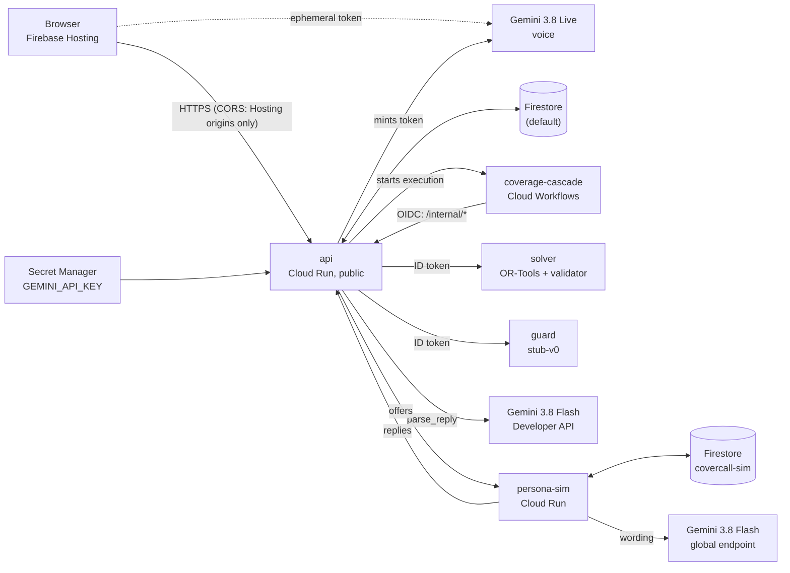

# CoverCall

**A shift lead at a small three-outlet café chain in Singapore gets a sick call at 6:02am. The outlet opens at 7:00.** CoverCall finds legal, low-cost cover in seconds, reads the plan back for approval, messages candidates, re-plans on declines and counter-offers, and escalates to the lead with ranked fallbacks when time runs out. **The one design rule: a language model never decides legality and never owns control flow.** Legality and cost come from a constraint solver and an independent validator. The state machine runs in Cloud Workflows. Gemini only listens, speaks and reads replies.

- **Live app:** https://covercall-demo-2026.web.app (no sign-in)
- **Demo video:** [DEMO VIDEO LINK](https://youtu.be/0daFPWX4gI4)
- **Theme:** Future of Work & Enterprise Productivity
- **All data is synthetic.** No real staff, employers or messages.

---

## Try it in 3 minutes

**A. Tap through a sick call.** Open the app and tap **"6:02am sick call"**.
1. You see up to three ranked legal plans and a greyed-out warning: *"Priya: 70 of 72 overtime hours used this month."* (rule `SG-EA4-OT-CAP-72`, linked to the MOM page).
2. The read-back card asks for approval. Tap **Approve**.
3. The timeline shows a decline, a counter-offer and a no-reply, then **FILLED**: "Fiona 07:00-09:00 + Lucas 09:00-15:00". Measured in production: 1.1 to 1.9 minutes (`gap-0005`, `gap-0006`, `gap-0011`, `gap-0013` in [HANDOFF](docs/HANDOFF.md)).

**B. Report it by voice** (Chrome; allow the microphone). Click **Hands-free** and say:
> "Ali is sick for the 7am barista shift at Bugis on Tuesday, 3 November."

CoverCall reads the server's approval sentence back. Say **"yes, approve"** and watch the cascade run. **Say the date.** The synthetic roster covers 3–8 Nov 2026 and production runs on the real clock, so "7am" alone means today, when Ali has no shift.

| You say | What happens | Evidence |
|---|---|---|
| No date, or a shift that is not on the roster | CoverCall asks which shift; no gap is created | `tests/test_read_routes.py::test_report_absence_resolves_names_or_asks` |
| A name that is not on the roster | CoverCall asks who is absent | same test |
| Anything but a clear yes at the read-back ("hmm maybe") | Counts as a no; nothing is sent to staff | `tests/test_cascade.py::test_voice_approval_needs_a_clear_yes`; `web/src/voice/voiceProvider.test.ts` |
| (Staff side) an unclear or low-confidence reply | Treated as a decline, never an accept | `tests/test_gemini.py::test_low_confidence_error_and_timeout_are_never_accept` |

**C. Tap "Nobody replies".** Every offer times out. The gap goes to **ESCALATED** with ranked fallbacks; pick one and it is **RESOLVED**. Measured in production: 2.6 and 2.8 minutes (`gap-0007`, `gap-0012`). Waits are compressed ×60, and the gap card says "Simulated time (demo compression ×60)".

**D. Check the evidence.** **Trace replay** shows every event and the server's hash-chain check. **How we know it's safe** (`/evals`) says "No eval run yet" instead of showing numbers we have not produced there. **About** (`/about`) lists the live model IDs from [`GET /status`](https://covercall-api-584069229211.asia-southeast1.run.app/status).

**Usage notes**
- Voice tokens are limited to 20 per IP and 120 overall per 10 minutes (`services/api/app/live.py`; `tests/test_live_token.py::test_rate_limits_return_429`, `::test_default_limits_allow_a_demo_burst_from_one_phone`). Every tap on Hands-free or Push-to-talk uses one. Past the limit, voice falls back straight to text (push-to-talk would hit the same limit); try voice again a few minutes later.
- Every run creates its own synthetic gap and leaves the shared roster unchanged, so judges do not affect each other ([0023](docs/decisions/0023-scenario-overlay-and-gemini-on.md), [0024](docs/decisions/0024-demo-isolation-and-voice-live.md); `tests/test_dev_server.py::test_s017_twice_in_a_row_gives_identical_plans` and `::test_demo_isolation_same_lead_report_twice_gives_identical_plans`).
- Staff replies come from simulated personas (`services/persona_sim/`). No real person is messaged.

---

## The problem and who it is for

**The user is a shift lead with ten minutes before opening.** Today they scroll a group chat and call whoever usually says yes. That breaks things a lead cannot check at 6am:
- **Employment Act Part 4 limits:** 72 overtime hours a month, 12 hours a day, rest days and breaks.
- **Avoidable overtime:** the usual first pick is often the person already near the cap.
- **Food safety:** a barista whose SFA Food Safety Course Level 1 has lapsed must not handle food.
- **Fairness:** the same reliable person gets asked every time.

**Input:** an absence (by voice or a scenario button). **Output:** a legal plan the lead approves, staff outreach, and either committed cover or a recorded escalation, all in a hash-chained event log.

**Data (synthetic and reproducible).** `python -m datagen build --seed 42` generates 3 outlets (Bugis, Tampines, Jurong East), 33 staff, the roster, overtime ledgers, and 60 golden and 40 held-out scenarios ([`datagen/`](datagen/), [`data/`](data/), [`evals/datasets/`](evals/datasets/); decision [0007](docs/decisions/0007-synthetic-data.md)). `tests/test_datagen.py::test_committed_data_matches_generator` checks the files match the generator byte for byte.

**Rules.** 15 rule specs in [`policy/rules/`](policy/rules/), each with its source and at least two tests (`python policy/lint_rules.py`):

| Source | Rules | Page last updated |
|---|---|---|
| [MOM: hours of work, overtime and rest days](https://www.mom.gov.sg/employment-practices/hours-of-work-overtime-and-rest-days) | `SG-EA4-OT-CAP-72`, `SG-EA4-DAILY-MAX-12H`, `SG-EA4-BREAKS`, `SG-EA4-REST-DAY`, `SG-EA4-NORMAL-HOURS`, `SG-EA4-OT-RATE`, `SG-EA4-REST-DAY-PAY` | 2025-07-24 |
| [MOM: who the Employment Act covers](https://www.mom.gov.sg/employment-practices/employment-act/who-is-covered) | `SG-EA4-COVERAGE` | 2025-07-24 |
| [MOM: overtime for part-time employees](https://www.mom.gov.sg/employment-practices/part-time-employment/overtime) | `SG-PT-OT-RATE` | 2025-07-25 |
| [SFA: WSQ Food Safety Course Level 1](https://www.sfa.gov.sg/food-handler-hygiene-officer/training-courses/wsq-food-safety-course-level-1) | `SG-SFA-FSC-L1` | 2026-08-24 |
| Synthetic company policy ([`policy/company.yaml`](policy/company.yaml)) | `CO-AGE-SCOPE`, `CO-FAIRNESS`, `CO-OPENER-KEYHOLDER`, `CO-REST-BETWEEN-SHIFTS`, `CO-STATION-SKILL` | n/a |

The public pages were checked live on 2026-10-18 ([0002](docs/decisions/0002-model-ids-and-sources.md)).

---

## Results and impact

**CoverCall breaks no hard rules. The usual "ask the most reliable person first" baseline breaks 15 on the held-out set.** These are real runs of `python -m evals.compare --set heldout` and `--set golden` (synthetic SGD, simulated minutes):

| Held-out (n=40) | CoverCall | Baseline |
|---|---|---|
| Gaps filled | 36/40 | 40/40 |
| Hard-rule violations | **0** | 15 (in 14 scenarios) |
| Total overtime cost | S$0.00 | S$2,422.67 |
| Total incremental labour cost | S$1,005.00 | S$4,142.67 |
| Median time to fill (simulated min) | 1.06 | 3.05 |
| Fills arriving after shift start | 0 | 2 |

| Golden (n=60) | CoverCall | Baseline |
|---|---|---|
| Gaps filled | 50/60 | 59/60 |
| Hard-rule violations | **0** | 19 (in 18 scenarios) |
| Total overtime cost | S$75.52 | S$3,434.68 |
| Total incremental labour cost | S$1,746.52 | S$6,322.68 |
| Median time to fill (simulated min) | 1.82 | 1.78 |

**The honest caveat: CoverCall fills fewer gaps.** When no legal cover exists in time, it escalates to the lead rather than break a rule: 4 held-out and 10 golden gaps escalated and were resolved. The baseline ignores travel and deadlines. Medians are S$0 for both sides, because most gaps can be covered within contract hours. Staff outside Part 4 are costed at S$0 on both sides ([0008](docs/decisions/0008-baseline-and-compare.md)).

**Production journeys (tap, measured):** S-017 FILLED in 1.1, 1.1, 1.9 and 1.3 minutes. "Nobody replies" RESOLVED in 2.6 and 2.8 minutes. `verify_chain` was OK on every run ([HANDOFF](docs/HANDOFF.md), sections "Final engineering" and "Voice live").

**Why it is feasible.** It is a web page: no install, no new hardware. It works from the roster a chain already keeps. A `RosterProvider` adapter for real rostering systems is **planned** (design doc §9.3). Rules are data with cited sources, so adding one means a YAML spec plus tests.

---

## How it works



**One gap, step by step** (production `gap-0013`, execution `c592b95a-fa9c-4b9e-ac67-56e174f26632`):
1. **REPORTED:** `gap.reported`. The lead's raw text stays server-side ([0013](docs/decisions/0013-raw-text-out-of-workflow.md)).
2. **GUARDED:** the guard labels the input first. Any guard failure holds the gap.
3. **SOLVED:** CP-SAT ranks plans and the validator re-checks every one (`plan.solved`).
4. **OUTREACH:** the lead approves the exact read-back with a single-use nonce (`plan.approved`). Offers go out only after this.
5. **Replies:** `reply.decline`, `reply.counter` (a re-plan around the offered window), `offer.timeout`, then `reply.accept`.
6. **COMMITTING → FILLED:** one transaction re-checks the plan with the validator and records the cover (`commit.ok`).

Only the workflow changes state. It does so through `/internal/*` routes, each of which appends one hash-chained event (`services/api/app/events.py`, `TRANSITIONS`).

**Google services**

| Service | What it does here | Evidence |
|---|---|---|
| Gemini 3.8 Live (`gemini-3.8-live`, v1beta) | Voice: listens, reads back, calls five server-side tools | `GET /status` shows `voice: live`; `services/api/app/live.py`; `web/src/voice/liveSession.ts`; api revision `covercall-api-00006-bip` |
| Gemini 3.8 Flash (`gemini-3.8-flash`) on the Gemini Developer API (v1beta) | Reads staff replies into a fixed schema (`PARSER_BACKEND=developer`, [0026](docs/decisions/0026-parse-reliability.md)) | `services/agent/app/gemini.py`; `GET /status` shows the agent role's provider; events record `parser_impl`, `parser_backend` and prompt SHA-256 |
| Gemini 3.8 Flash (`gemini-3.8-flash`) on the Enterprise Agent Platform, global endpoint | Writes persona wording (falls back to templates on error) | `services/persona_sim/app/main.py`; events record `text_impl` (`gap-0005`) |
| Cloud Run | Six services: api, solver, guard, agent, persona-sim, connectors | `infra/40_deploy_services.sh`; `services/*/Dockerfile` |
| Cloud Workflows | The state machine, with durable callback waits | `workflows/coverage_cascade.yaml`; executions `c592b95a…`, `b18202c3…` |
| Firestore | Gaps, events, plans and offers; `covercall-sim` holds personas | `services/common/store.py`; `infra/10_firestore.sh` |
| Firebase Hosting | The web app, plus a `voice` preview channel | `firebase.json`; `infra/70_hosting.sh` |
| Secret Manager | `GEMINI_API_KEY` (voice tokens and reply parsing), readable only by the api service account | `infra/25_secrets.sh` |
| Cloud Build, Artifact Registry | Image builds | `infra/build-images.yaml`; `infra/30_images.sh` |
| Gemini 4 Argon | CI eval judge | **Planned, not yet running** (`config/models.yaml`; [0020](docs/decisions/0020-eval-judge-gemini-4-argon.md)) |

---

## Grounding and guardrails

**There is no Google Search grounding, on purpose.** The authoritative facts are the chain's own roster and the statutory rules, encoded as specs with cited sources. Legality is computed, not generated.

| Guardrail | How it works | File | Test |
|---|---|---|---|
| Solver plus independent validator | CP-SAT proposes; a plain-Python validator (standard library and yaml only) re-checks every plan. A disagreement is a P0 and holds the gap | `policy/compile_cpsat.py`, `policy/validate.py` | `tests/test_policy.py::test_validator_imports_only_stdlib_and_yaml`, `::test_property_every_solver_plan_passes_validator`, `::test_property_engines_agree_on_every_rule` |
| Guard first, fail closed | Every input is labelled before parsing. A guard error holds the gap; flagged replies are quarantined | `services/guard/`; `workflows/coverage_cascade.yaml` | `tests/test_cascade.py::test_guard_failure_fails_closed_to_held`, `::test_injected_reply_is_quarantined_and_never_reaches_the_planner` |
| Structured reply parsing | Schema-validated output with one retry, then `unclear`. Confidence below 0.7, errors and timeouts give `unclear`, never an accept. Staff text sits inside delimiters as data | `services/agent/app/gemini.py` | `tests/test_gemini.py` (all six tests) |
| Read-back approval | The exact sentence plus a single-use server nonce; voice needs a clear yes | `services/api/app/core.py` | `tests/test_cascade.py::test_voice_approval_needs_a_clear_yes`; `tests/test_read_routes.py::test_approval_route_only_while_pending` |
| No outbound message without approval | Offers are refused without a covering approval (the `unapproved_outbound` P0 counter was 0 in every evals run) | `services/api/app/core.py` | `tests/test_cascade.py::test_no_offer_without_covering_approval` |
| Locked voice session | The token fixes the model, tools and system instruction; tool calls run on the server | `services/api/app/live.py` | `tests/test_live_token.py::test_token_shape_and_locked_constraints` |
| PII redaction | Applied before every write | `services/common/pii.py`; `services/api/app/events.py` | `tests/test_events.py::test_redaction_before_write` |
| Hash-chained event log | A SHA-256 chain, verified by the server on every trace read | `services/api/app/events.py` | `tests/test_events.py::test_tampered_payload_is_detected` |
| Least privilege | Private services need an ID token; `/internal/*` needs the workflow's OIDC token; CORS allows only the Hosting origins; secrets live only in Secret Manager; the browser has no Firestore access | `infra/20_iam.sh`; `infra/firestore.rules`; `services/api/app/main.py` | `tests/test_workflow.py::test_every_http_call_uses_oidc_and_the_retry_policy`; `tests/test_read_routes.py::test_cors_allows_only_configured_origins`, `::test_no_read_route_leaks_nonce_callback_url_or_raw_text` |

---

## Latency and reliability (measured only)

- **Gemini parse:** on 21 Oct the Vertex global endpoint failed about 75-90% of parses (504, 429, 500), and each failure was a fail-closed decline. The 4.7 s seen earlier was a deadline, not the model: the SDK sends `X-Server-Timeout` and Vertex stops about 3.4 s before it. Parses now run on the Gemini Developer API (12/12 in the same window, median 3.6 s) and retry 429/500/503/504 within a 30 s budget, logging each failure on the event ([0026](docs/decisions/0026-parse-reliability.md)). An error is still never an accept.
- **Journeys:** fills took 1.1 to 1.9 minutes and escalations 2.6 to 2.8 minutes in production, with waits compressed ×60 (see Results).
- **Retries:** every workflow HTTP call has 3 attempts with exponential backoff, and every state change carries an idempotency key (`workflows/coverage_cascade.yaml`; `test_every_http_call_uses_oidc_and_the_retry_policy`).
- **Warm instances:** api, solver, guard, agent and persona-sim each keep one warm instance; connectors scales to zero (`infra/40_deploy_services.sh`).
- **Found in production and fixed:** Firestore rejects reads after writes in a transaction, which broke `accept` and `commit`; the in-memory test store now enforces the same rule. Also fixed: a database ID that was too short, an api image missing a module, and a deploy script that could not have worked ([HANDOFF](docs/HANDOFF.md), section "Deployment").
- **Limits:** voice tokens are capped at 20 per IP and 120 overall per 10 minutes, keyed on the caller IP that Cloud Run appends to `X-Forwarded-For`. The counts are held in each instance's memory.

---

## Engineering decisions

- [0005](docs/decisions/0005-rule-semantics.md): one rule semantics, shared by the solver and the validator.
- [0006](docs/decisions/0006-solver-formulation.md): the CP-SAT formulation, objective weights and determinism.
- [0009](docs/decisions/0009-timing.md): the escalation time locks at approval, and reply windows are clamped to it.
- [0011](docs/decisions/0011-fan-out.md): fan-out uses one callback endpoint per offer.
- [0013](docs/decisions/0013-raw-text-out-of-workflow.md): raw text stays out of the workflow; api proxies the guard and parser.
- [0014](docs/decisions/0014-commit-cancel-and-cost-saved.md): commit re-check, cancel through the workflow, approvals and cost saved.
- [0019](docs/decisions/0019-live-ephemeral-tokens-v1beta.md): Live ephemeral tokens use v1beta.
- [0020](docs/decisions/0020-eval-judge-gemini-4-argon.md): the eval judge is Gemini 4 Argon (planned).
- [0021](docs/decisions/0021-global-model-endpoint.md): Enterprise Agent Platform model calls use the global endpoint; services stay in asia-southeast1.
- [0022](docs/decisions/0022-sim-database-id.md): the persona database is named `covercall-sim`.
- [0023](docs/decisions/0023-scenario-overlay-and-gemini-on.md): scenario gaps use a per-gap overlay, and Gemini Flash is switched on.
- [0024](docs/decisions/0024-demo-isolation-and-voice-live.md): demo isolation for lead-reported gaps, and voice goes live.
- [0025](docs/decisions/0025-demo-clock-offset.md): deadlines are judged on a clock 7 days behind, so the fixed 3-8 Nov roster stays ahead through judging.
- [0026](docs/decisions/0026-parse-reliability.md): reply parsing retries transient errors and runs on the Gemini Developer API.

---

## What it can and cannot do

- **The guard is a deterministic stub (`stub-v0`), not a model.** The Gemma guard is planned.
- **Travel times are placeholders,** not Routes API data (`data/travel_cache.json`).
- **Production runs on the real clock.** Voice reports must name the date, and fan-out does not show live because the deadlines are two weeks away.
- **A Gemini parse can change which legal plan fills.** In `gap-0011`, S-017 filled with Shreya instead of the usual Fiona + Lucas. The fill was legal and recorded, but the demo is less repeatable.
- **No real messaging.** Telegram is not built; the connectors service answers 501.
- **No BigQuery eval dashboard and no live Cloud Build gate.** `/evals` says "No eval run yet".
- **Staff outside Employment Act Part 4 are costed at S$0;** contractual pay is not modelled.
- **Public holidays are not encoded.**
- **`gap-0001` is stranded** in OUTREACH after an early failed execution; the cancel route cannot reach it.
- **Live API ephemeral tokens are a Preview feature** on Google's side.

The full list is in [`docs/OPEN_ITEMS.md`](docs/OPEN_ITEMS.md).

---

## Reproduce and run locally

You need Python 3.12 with [uv](https://docs.astral.sh/uv/), and Node for the web app (tested with Node 24).

From the repo root:

```bash
uv venv --python 3.12 .venv
uv pip install --python .venv -r pyproject.toml --extra dev
source .venv/bin/activate                  # Windows: .venv\Scripts\activate

python policy/lint_rules.py                # 15 rules, each with a full source and >= 2 tests
python -m datagen build --seed 42          # regenerates data/ and evals/datasets/ (byte-identical)
pytest                                     # unit, property, cascade and contract tests
python -m evals.compare --set heldout      # the Results table above (also --set golden)
python -m evals.runners.local_cascade      # S-017 to FILLED and S-002 to RESOLVED, locally
python -m evals.runners.dev_server --port 8080   # local api and workflow driver, in-memory store
```

In a second terminal, from `web/`:

```bash
npm ci
VITE_API_BASE_URL=http://127.0.0.1:8080 npm run dev   # then open http://localhost:3000
npm test                                              # web unit tests
npx playwright test                                   # tap-only end-to-end run (starts its own servers; stop the two above first)
```

To deploy to your own project, run the scripts in [`infra/`](infra/) in the order given in [`docs/HANDOFF.md`](docs/HANDOFF.md) (deploy steps).

**Repo map**

| Folder | What is in it |
|---|---|
| [`policy/`](policy/) | Rule specs, the CP-SAT compiler, the independent validator, timing |
| [`services/`](services/) | The six Cloud Run services and shared code (store, PII, models) |
| [`workflows/`](workflows/) | The Cloud Workflows state machine |
| [`web/`](web/) | The React app, the voice client and end-to-end tests |
| [`datagen/`](datagen/), [`data/`](data/) | The synthetic data generator and its output |
| [`evals/`](evals/) | Golden and held-out scenarios, the baseline comparison, local runners |
| [`baseline/`](baseline/) | The most-reliable-first baseline |
| [`prompts/`](prompts/) | Prompt files (their SHA-256 is recorded on events) |
| [`config/`](config/) | Pinned model IDs |
| [`infra/`](infra/) | Deploy scripts and Firestore rules |
| [`tests/`](tests/) | Python tests |
| [`docs/`](docs/) | Design doc, decisions, HANDOFF, open items, runbook |

*All data is synthetic.*
